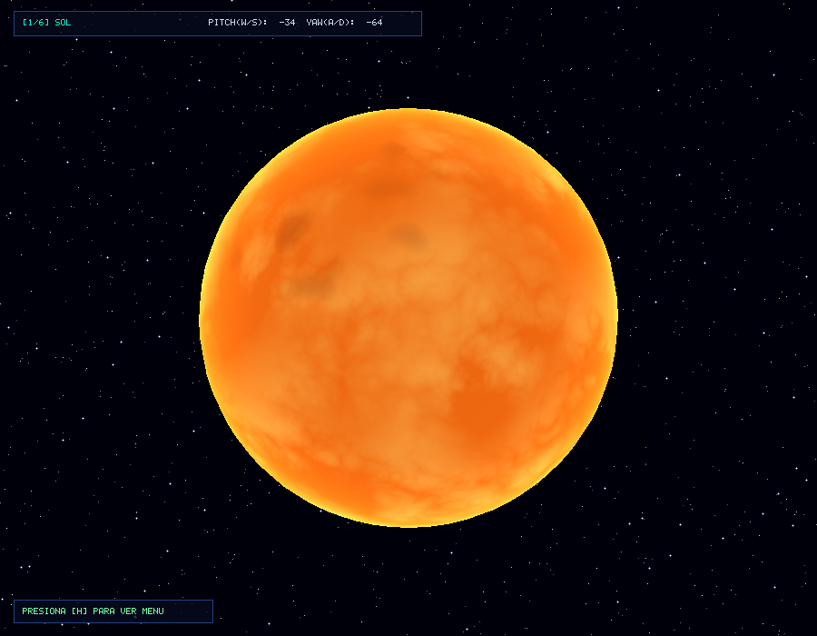
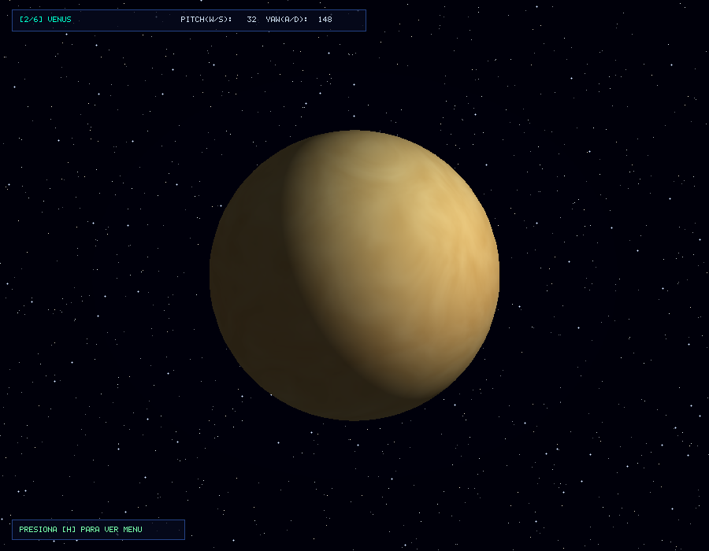
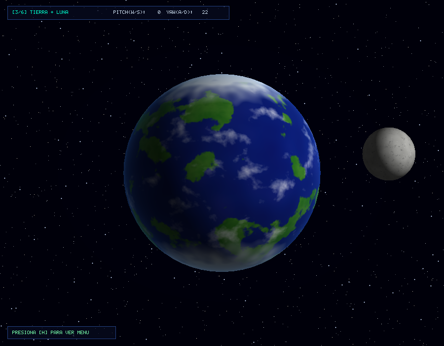
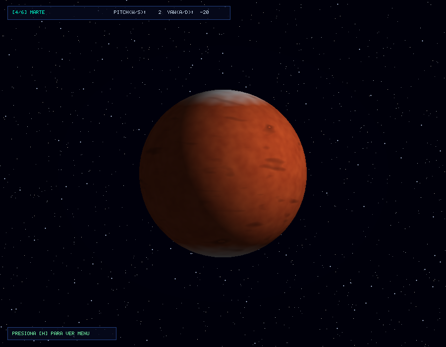
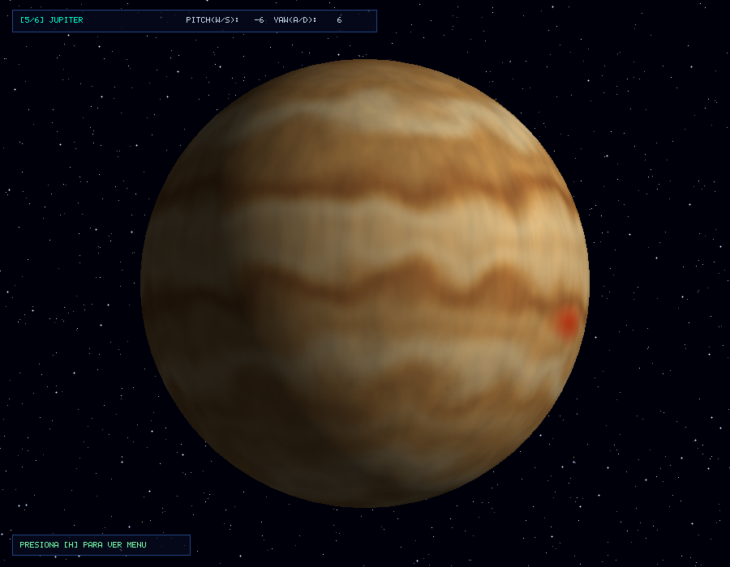
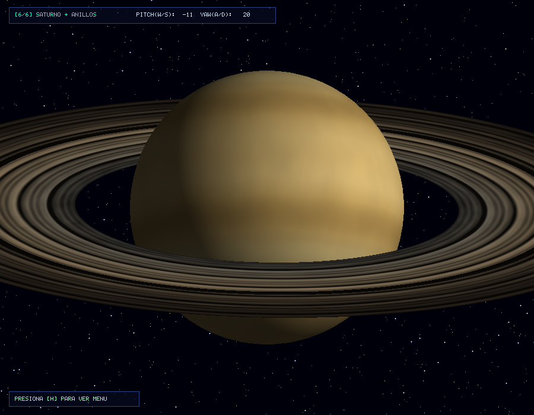

# Laboratorio 5: Shaders Procedurales de Cuerpos Celestes
**Curso:** Gráficas por Computadora  
**Autor:** Pedro Caso - 241286  

---

## Descripción del Proyecto

Este proyecto consiste en un **software renderer 3D** programado completamente en **Rust** desde cero, sin utilizar librerías gráficas de bajo nivel tales como OpenGL, DirectX o Vulkan, ni motores gráficos. Tampoco se hace uso de texturas o materiales predefinidos: **todos los colores, patrones superficiales, atmósferas y fenómenos astronómicos se calculan proceduralmente mediante funciones matemáticas y algoritmos de ruido**, tales como Perlin Noise 3D, Movimiento Browniano Fraccional FBM, Turbulencia y Domain Warping dentro del fragment shader.

El sistema permite visualizar e interactuar en tiempo real con 6 cuerpos celestes principales, incluyendo satélites naturales y sistemas de anillos planetarios.

---

## Controles de la Aplicación

| Tecla | Acción |
|---|---|
| `1` | Cambiar a **Sol**, estrella emisiva con plasma y corona |
| `2` | Cambiar a **Venus**, planeta rocoso con densa atmósfera arremolinada |
| `3` | Cambiar a **Tierra + Luna**, shader de 4 capas y satélite natural orbitando |
| `4` | Cambiar a **Marte**, planeta rocoso rojo con cañones y casquetes polares |
| `5` | Cambiar a **Júpiter**, gigante gaseoso con bandas turbulentas y Gran Mancha Roja |
| `6` | Cambiar a **Saturno + Anillos**, gigante gaseoso dorado con sistema de anillos concéntricos |
| `W` / `S` / `Flechas Arr/Abj` | Rotar verticalmente el planeta, Pitch en eje X |
| `A` / `D` / `Flechas Izq/Der` | Rotar horizontalmente el planeta, Yaw en eje Y |
| `H` | Alternar entre ocultar y mostrar el menú de ayuda en pantalla |
| `R` | Reiniciar el ángulo de rotación a su posición original |
| `P` | Guardar captura de pantalla actual en archivo `.png` |
| `ESC` | Salir de la aplicación |

---

## Criterios de Evaluación y Puntos Obtenidos

| Criterio | Puntos Posibles | Estado | Detalle |
|---|---|:---:|---|
| **Creatividad del diseño** | 30 pts | pendiente | 6 cuerpos celestes diferenciados visualmente con paletas realistas, fondo cósmico de estrellas y efectos estéticos de iluminación y emisión. |
| **Complejidad de shaders con 4 capas** | 40 pts | Cumplido | Implementado en la **Tierra**: 1. Océanos profundos y someros, 2. Continentes con biomas como bosques, selvas y desiertos, 3. Casquetes polares de hielo, 4. Nubes atmosféricas animadas con FBM. |
| **Planetas extra** | 30 pts | Cumplido | 3 obligatorios como Sol, Tierra y Júpiter, más 3 extras como **Venus**, **Marte** y **Saturno** para alcanzar el máximo de 30 pts. |
| **Sistema de anillos en gigantes gaseosos** | 20 pts | Cumplido | Implementado en **Saturno** con modelo de disco independiente y shader de bandas concéntricas con la División de Cassini. |
| **Luna implementada** | 20 pts | Cumplido | Satélite natural orbitando la Tierra en tiempo real con shader procedural de cráteres y mares basálticos. |
| **Rotación y traslación opcionales** | Extra | Cumplido | Control de rotación 3D manual con WASD en Pitch y Yaw, con traslación y órbita fija de la Luna y los anillos sincronizados con el cuerpo celeste. |

---

## Detalle de Shaders y Capas

### 1. El Sol, Estrella Emisiva
* **Capa 1, Base fotoferica:** Tono amarillo anaranjado de alta luminosidad.
* **Capa 2, Turbulencia de plasma:** Simulación de celdas convectivas y flujos de plasma caliente mediante ruido turbulento 3D.
* **Capa 3, Manchas solares:** Regiones oscuras de menor temperatura generadas por un umbral estocástico de ruido Perlin de baja frecuencia.
* **Capa 4, Corona solar y resplandor de borde:** Resplandor atmosférico emisivo en los bordes calculado con una aproximación de Fresnel independiente de la iluminación externa.

### 2. La Tierra, 4 Capas de Color y 40 Puntos de Complejidad
* **Capa 1, Hidrosfera u Oceanos:** Fondo azul profundo oceánico interpolado con tonos cian en plataformas continentales someras mediante ruido Perlin.
* **Capa 2, Litosfera y Biomas continentales:** Masas de tierra delimitadas proceduralmente por FBM con 6 octavas. Incluye variación de vegetación entre bosques templados verdes, selvas tropicales y desiertos arenosos en tonos ocres.
* **Capa 3, Criosfera y Casquetes Polares:** Hielo polar blanco en ambos polos cuando el valor absoluto de la coordenada vertical supera 0.70, con transiciones irregulares dependientes del ruido para simular glaciares y costas fractales.
* **Capa 4, Atmosfera y Nubes:** Manto de nubes blancas semitransparentes generado con una semilla de ruido independiente y domain warping, fijado sólidamente a la rotación de la masa terrestre.

### 3. Júpiter, Gigante Gaseoso
* **Capa 1, Base cremosa:** Matiz base beige dorado de la atmósfera profunda.
* **Capa 2, Bandas latitudinales:** Franjas alternadas oscuras y claras utilizando funciones senoidales moduladas por la latitud.
* **Capa 3, La Gran Mancha Roja:** Vórtice anticiclónico elíptico en el hemisferio sur con ruido arremolinado en su interior y caída suave en sus bordes.
* **Capa 4, Turbulencia y cizalladura zonal:** Domain warping y FBM para simular las ondulaciones y vórtices caóticos en las fronteras entre bandas.

### 4. Venus, Planeta Rocoso con Atmosfera Densa
* **Capa 1, Tono base sulfurico:** Amarillo pálido y anaranjado cálido característico del dióxido de carbono y ácido sulfúrico.
* **Capa 2, Vortices de nubes densas:** FBM con domain warping en capas múltiples simulando corrientes de viento super-rotatorias.
* **Capa 3, Gradiente latitudinal:** Variación de densidad atmosférica y temperatura de ecuador a polos que gira solidariamente con el planeta.

### 5. Marte, Planeta Rocoso
* **Capa 1, Regolito ferroso:** Color base rojo óxido y terracota.
* **Capa 2, Albedo y variaciones geologicas:** Regiones oscuras y mesetas polvorientas mediante 5 octavas de FBM.
* **Capa 3, Casquetes de hielo de dioxido de carbono:** Polos blancos brillantes en los extremos norte y sur anclados a la rotación 3D del planeta.
* **Capa 4, Cañones y fallas tectonicas:** Estrías oscuras direccionales simulando accidentes geográficos tales como Valles Marineris.

### 6. Saturno y sus Anillos
* **Planeta:** Bandas gaseosas sutiles y elegantes en tonos dorados, ámbar y trigo, más suaves y armoniosas que las de Júpiter.
* **Sistema de Anillos en modelo independiente:** Geometría de disco plano horizontal en el plano XZ inclinado a 26.7 grados. El shader evalúa la distancia radial para generar anillos concéntricos con variaciones de densidad y opacidad, incorporando divisiones astronómicas reales como la División de Cassini y la brecha de Encke.

### 7. La Luna, Satélite de la Tierra
* Superficie regolítica grisácea con microcráteres de alto impacto y grandes planicies basálticas oscuras correspondientes a los mares lunares.

---

## Galería de Renderizado

| Sol, Estrella | Venus |
|:---:|:---:|
|  |  |

| Tierra y Luna | Marte |
|:---:|:---:|
|  |  |

| Júpiter, Gigante Gaseoso | Saturno y Anillos |
|:---:|:---:|
|  |  |

---

## Compilación y Ejecución

Para ejecutar la aplicación con el máximo rendimiento, recomendado en software renderers debido a la optimización de bucles de rasterizado y ruido:

```bash
cargo run --release
```

Para generar automáticamente todas las capturas de pantalla de la galería:

```bash
cargo run --release -- --screenshots
```
